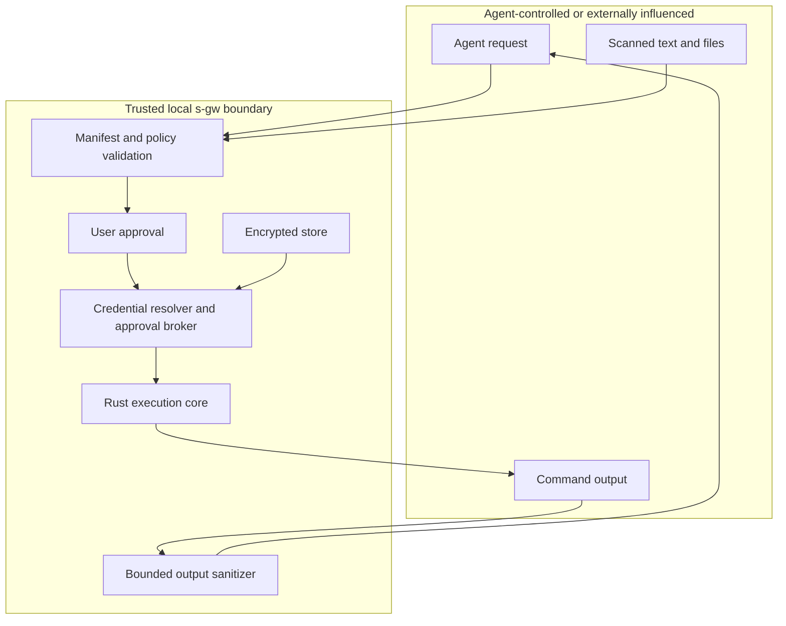

# Threat Model

## Purpose

s-gw reduces the chance that raw credentials are exposed to coding agents, model context, chat transcripts, tool results, or routine shell arguments. It keeps credential redemption and approval on the user's machine.

This document describes the intended security boundary for the current preview. It is not a claim of formal verification or independent audit.

## Protected Assets

- raw credential values and local unlock material;
- credential-store pointers and encrypted ledger contents;
- approval decisions and reusable-grant scope;
- command, environment, working-directory, and SSH destination policy;
- sanitized execution output and audit records.

## Trust Boundaries

The local operating system account, s-gw broker and Rust core processes, operating system credential store, approved executable, and user approval decision are trusted for an approved action. Agent input, scanned content, command arguments, destinations, and command output are treated as untrusted.

## Intended Guarantees

- Agent-facing interfaces use typed handles and metadata rather than raw values.
- A secret-backed action must match the handle's allowed command or owned SSH policy.
- Pending actions do not execute until a policy or local user decision approves them.
- Reusable approvals for environment commands are bound to the exact executable, arguments, credential bindings, and working directory from the approved request. Owned SSH approvals remain bound to the SSH target and port so later commands use the same s-gw-controlled connection.
- A direct credential-backed action cannot select `/usr/bin/security` as its executable, even when a handle policy, approval policy, or reusable grant would otherwise permit it. This does not inspect commands later spawned by an approved interpreter or wrapper.
- Credential and unlock values entered through supported commands use stdin instead of process arguments.
- The loopback console requires a per-session token for state-changing operations.
- Known raw credential values are replaced in captured command output before it is returned to the caller.
- Approved environment commands run with a cleared child environment and only the allowlisted system variables plus approved credential bindings.
- The broker verifies that the Rust result contains no known raw credential and that its proof matches the request and sanitized output.
- Approval, execution, denial, failure, and policy activity is recorded locally.

## Attacker Capabilities Considered

- A coding agent may create arbitrary tool requests and misleading reasons.
- Repository content may contain prompt injection or request unsafe commands.
- A local web page may attempt to call the loopback console.
- A child process may print the injected credential in its output.
- An attacker may guess handles, request IDs, or local API routes.
- A request may be interrupted by process exit, sleep, or a hung command.

## Non-Goals And Residual Risk

s-gw does not protect against:

- compromise of the current operating system account, kernel, credential store, or s-gw process;
- a malicious or compromised executable that the user approves to receive a credential;
- screen capture, keylogging, debugger access, process-memory inspection, or privileged endpoint monitoring;
- network exfiltration performed by an approved command;
- every transformed, encoded, hashed, fragmented, or derived representation of a credential in output;
- secrets the user pastes directly into chat, source files, terminal commands, or agent configuration;
- credential access by tools that bypass s-gw entirely;
- broad prompt, file, terminal, or operating system interception solely through MCP registration;
- denial of service, destructive approved commands, or incorrect user approval decisions.

The Linux desktop service makes the user's home read-only rather than hiding it because npm, Node.js, and approved command targets may live there. This prevents service writes outside the s-gw ledger and recovery paths, but a compromise of the broker process could still read files already readable by that operating-system account. Install s-gw and Node.js under system paths when a stricter home-filesystem boundary is required, and review `systemd-analyze security --user s-gw.service` on the deployed host.

Output sanitization is a last line of defense, not a data-loss-prevention guarantee. Keep allowed commands narrow, review destinations and arguments, and use low-privilege credentials with independent provider-side controls.

## Secure Use

- Enroll credentials from a local terminal or supported UI, never from agent chat.
- Prefer macOS Keychain, Linux Secret Service, or Windows Credential Manager over environment-provided unlock material.
- Use absolute executable paths for command grants where practical.
- Keep reusable approvals short. Ordinary MCP agent names are client-declared; use a verified OS principal before relying on a same-agent scope as a security boundary.
- Expect a new approval when an environment command's arguments change.
- Treat unlimited approvals and high-severity credentials as exceptional.
- Review SSH destinations, ports, and remote commands before approval.
- Keep the operating system, Node.js, s-gw, and credential providers updated.
- Review the local audit log and revoke stale policies and grants.

## Reporting

Report suspected boundary failures through the private process in [SECURITY.md](../SECURITY.md). Do not test with credentials or systems you do not own or have permission to use.

## Opt-in Anthropic mode

The agent process is confined by Anthropic sandbox-runtime. Its MCP client reaches an authenticated loopback broker that owns approved SSH and HTTPS operations outside confinement. Credentials enrolled in s-gw are resolved only by s-gw. HTTPS uses destination TLS directly; no interception certificate or TLS credential replacement is added.

The current launcher and ordinary MCP server do not establish a distinct OS identity for each agent. The ordinary server accepts a client-declared name, but automatic allow rules and reusable grants require a verified OS principal. Ordinary MCP can submit owned HTTPS, SSH, and environment-command requests for manual approval, but cannot claim them; the operator CLI/UI can execute them. A verified endpoint supports agent execution of its own owned HTTPS and managed SSH requests. It does not yet offer target-based SSH or environment commands. A same-UID agent may still reach a capability held by another process, including the operator CLI. The opt-in Unix peer verifier and model relay transport are foundations; neither is connected to the live launcher. [OS identity design](agent-os-identity.md) lists the required per-platform controls and acceptance checks.

The same-UID path sandbox also cannot make a file confidential when an allowed workspace already contains a hardlink to it. A disposable macOS probe read a protected mode `0600` synthetic file through such a workspace link while direct access was denied. A dedicated agent UID with broker-private file permissions or a VM without secret mounts must enforce the stronger file boundary; inspect workspace provenance when using the current isolated-auth profile.

The ordinary browser console is a compatibility path: any local process that can load its page can obtain its session authority. `--operator-auth` protects one foreground listener, but every listener for the same store must be protected and unreachable from agent identities before operator-only approval can be claimed. Saved native agent sign-ins and direct outbound model/service TLS also remain available by default.

Approvals for owned operations bind their complete operation scope. The executor rechecks active authorization and monitors revocation. Regular SSH uploads use a digest-verified copy in the denied store directory before connecting. Named pipe approvals default to path and destination binding; the producer controls the streamed content. The opt-in `spooled-content-sha256` mode captures one nonempty FIFO stream in private broker storage before approval, binds its digest and destination, and verifies a copy again before connecting. Capture has a 30-second deadline, 32 MiB limit, eight-slot storage bound, and one-hour pending expiry; the slot is removed after the first execution or failed request creation. A repeat upload requires a new stream and request. Explicit read denies are also applied to the upload broker. Ordinary execution and SSH session semantics are unchanged.

Saved agent login credentials remain readable by default so existing logins work. Operators can deny known authentication paths explicitly or use `--deny-agent-auth`. A disposable macOS Keychain test found that this flag alone still permits native item retrieval. The additional opt-in `--deny-keychain` blocks both known Keychain service endpoints and denied the tested item read; complete Keychain isolation is not proven. The macOS `--allow-agent-keychain` exception exposes the encrypted login database, including other applications' encrypted entries, while leaving native item authorization in place. It is opt-in and explicit denies override it. This is a separate trust boundary from service credentials held by s-gw.

The pinned backend supports macOS and Linux. Native Windows Anthropic confinement is unavailable; existing Windows features remain supported. Linux requires delegated cgroup v2 for process-tree cleanup and fails before launching without it. Tests can explicitly exercise a fallback without cgroups; that fallback is not a production readiness claim.
